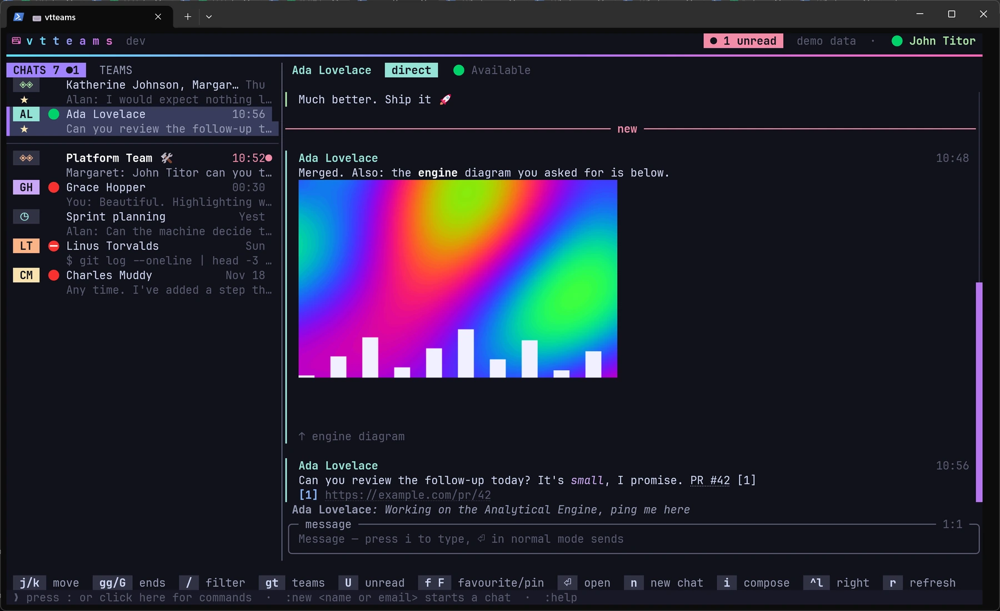

# vtteams

> There is no moat
> — [Prof. Sertac Karaman](http://karaman.mit.edu) (MIT)

This project was born out of an MIT course on AI Systems and Agents run by [Prof. Sertac Karaman](http://karaman.mit.edu) of MIT's Laboratory of
Information & Decision Systems (LIDS) of which Prof. Karaman is the director.  It is a case-study in "There is no moat"
an assertion of Prof. Karaman's.

It was supposed to be a 2hr workshop on using Claude to build an agent deployed to Cloudflare that gathered news items
per your instructions, using D1 to store it and then to build a UI for it.  Being familiar with claude-code and agentic
development, that took about 5 mins and I decided to build a TUI using Rust+ratatui rather than the usual boring Angular.

The TUI looked cool (well done Claude) and I thought "wouldn't it be awesome to have a TUI-Teams interface like this".
I spent the remainder of the workshop and some of my own time & tokens on the weekends to build this.

## Introduction

This project is an unashamedly AI generated, human guided terminal based UI for Teams chats, I haven't written a single
line of code by hand but everything it does was designed/described, adjusted and tweaked by me.

It is not affiliated with, endorsed by or sponsored by Microsoft. It talks to Teams through the documented
**Microsoft Graph** API, which is the official way and the default, but it also unofficially supports the Teams web API
because I didn't have Graph API access to my work account and there were already a few projects like msteams-mcp that
blazed that trail.



*The demo (`vtteams --demo`), with made-up people and conversations.*

## Disclaimer

vtteams is an independent project, for interest and research. It is not affiliated with, endorsed by or sponsored by
Microsoft. By default it signs in with Microsoft's own public client id ("Microsoft Graph Command Line Tools"; see
[Microsoft Graph](#microsoft-graph-the-official-way-and-the-default) below), which other command-line tools also use;
you can register your own instead.

The `--teams` mode is **unofficial**. It talks to Teams through the web API that the Teams web app itself uses, which
Microsoft has not published and does not sanction or support, and vtteams presents itself to that API as Microsoft's own
web client. It is not recommended. If you use it, you use it entirely at your own risk: it may breach Microsoft's terms
of service and your organisation's policies, it can be detected or blocked, the account it is used with could be
restricted, and it can stop working at any time. Do not use it with a work or school account unless your administrator
has said you may. **The official way to use Teams programmatically is Microsoft Graph**, which is what vtteams does by
default (leave out `--teams`).

The software is provided as is, without warranty of any kind, and you alone are responsible for how you use it (see the
[license](#license)). The design of the `--teams` mode builds on the work of others; see [Acknowledgements](#acknowledgements).

## Features

- **Chats and channels in a terminal**: recent chats on the left (and, with the Teams web backend, a TEAMS tab for your
  teams and channels), the conversation on the right, the message box underneath and a command panel on the bottom row.
- **Markdown both ways**: messages are shown as Markdown, code blocks are syntax-colored, and what you type in Markdown
  is sent as Teams formatting, with real `@mentions` and `:emoji:` shortcodes.
- **Pictures** drawn with the terminal's own graphics (Sixel, Kitty or iTerm2) where it has them, and as color block art
  where it does not; click one to open it full size.
- **Links you can follow**: numbered, shown in full and clickable, even when the sender's client shortened them.
- **The everyday things**: reply, react, edit your messages, search a chat or a whole team, favourites, unread markers,
  and start a chat with anyone in the directory (`Ctrl-n` or `:new`).
- **Who is around**: people's availability, status messages and out-of-office notes, and your own status, which you can
  set (`F9`).
- **Two keymaps**: by default it behaves like any text box and chat app; `--keymap vim` gives you modal vim keys.
- **A bell** for new messages, if you want one (`bell = "background"` or `"always"`).
- **Mouse**: click to open a chat, select a message or place the cursor; the wheel scrolls.
- Needs a modern truecolor terminal (Windows Terminal, Warp, Ghostty, Kitty, ...).

Channels, presence, favourites and searching the service need the Teams web backend; see [Status](#status). The exact
rules behind all of this are in [docs/details.md](docs/details.md).

The Teams connectivity lives in its own crate, [`crates/teams-client`](crates/teams-client/README.md), so other
projects can use it.

## Status

vtteams is early software. `AGENTS.md` lists what has not yet been verified against a live service or real terminal, and what rests on
tests and the documented behaviour only; the short version:

| | Tried against a real tenant |
|---|---|
| **Microsoft Graph** (the default) | **No.** Covered by tests and Microsoft's documentation only; see [Microsoft Graph](#microsoft-graph-the-official-way-and-the-default). |
| Teams web (`--teams`): reading chats, messages, rosters, unread, incremental sync | Yes |
| Teams web: favourites, editing a message | Yes |
| Teams web: marking read, reactions, availability (🟢🔴🟡) and setting your own status (F9), starting a chat (`:new`), a full 24-hour sign-in expiry end to end | No (tests only) |

Built and used on **Windows with Edge**, **Linux with Chrome** and **macOS with Chrome** (the browser is what the Teams
web sign-in drives); CI builds and tests all three systems.

Expect rough edges, and please report them (see
[Reporting a problem with a service](CONTRIBUTING.md#reporting-a-problem-with-a-service)).

## Install

You need a recent Rust toolchain (`rustup` installs the pinned one on first use) and a terminal with 24-bit color.
Linux, macOS and Windows are built and tested in CI.

```
git clone <this repository>
cd vtteams
cargo install --path .        # puts `vtteams` on your PATH; or: cargo build --release
```

A C compiler is needed to build (the syntax-coloring grammars are C). The default image mode draws with characters
every font has; see [Pictures](#pictures) for finer ones.

## Try it without an account

```
cargo run --release -- --demo
```

Demo mode has canned conversations (Rust/Python/ObjectScript code, a table, quotes, an image, reactions), a small
directory to search with `:new`, people who reply a few seconds after you send, and a message that arrives on its own.

## Signing in

### Microsoft Graph (the official way, and the default)

```
cargo run --release                # first run starts a device-code sign-in
```

You are shown a code and a URL (the code is also copied to your clipboard); sign in with your work account.

Delegated permissions requested: `User.Read`, `User.ReadBasic.All` (people search), `Chat.ReadWrite`,
`offline_access`. Without settings vtteams uses the public client id of Microsoft's own "Microsoft Graph Command Line
Tools" so that it works out of the box; that id is Microsoft's, not vtteams's, and your tenant may block it or require
admin consent. **The properly sanctioned set-up is your own app registration**, which also lets your administrator see
and control what the app may do:

1. Entra admin center > App registrations > New registration (single tenant is fine).
2. Authentication > *Allow public client flows* = **Yes**.
3. API permissions > Microsoft Graph > Delegated: the permissions above (grant consent if your tenant requires it).
4. Run with `--client-id <application id> --tenant <tenant id>` (or set `VTTEAMS_CLIENT_ID` / `VTTEAMS_TENANT`, or `client_id`
   and `tenant` in the [settings file](#settings-file)).

### Teams web API (`--teams`): unofficial

Read the [disclaimer](#disclaimer) first. This mode is provided for interest and research, is not sanctioned by Microsoft
and is not recommended; use Graph (above) for anything that matters.

```
cargo run --release -- --teams     # first run opens your browser on Teams
```

vtteams drives your own Edge or Chrome (Chromium also works) with a private profile, lets you sign in to the Teams web app
as you normally would, reads the refresh token that the web app stores, and from then on calls the same undocumented
service the web app calls, presenting itself as Microsoft's Teams web client (with Teams' client id). While the sign-in
browser is open it has an unauthenticated debugging port on the loopback interface (see [Security notes](#security-notes));
do not use it on a computer you share.

vtteams keeps only a refresh token and your identity; later runs renew silently, reopening the private profile headless when
needed. `vtteams logout` deletes all of it, including the profile (which is not encrypted: see
[Where your sign-in and cache are kept](#where-your-sign-in-and-cache-are-kept)). Use `--browser <path>` (or `VTTEAMS_BROWSER`) to pick a
specific browser, and set `backend = "teams"` in the [settings file](#settings-file) (or `VTTEAMS_BACKEND=teams`) to make it
the default.

Only a Chromium-family browser (Edge, Chrome, Chromium) can be driven this way, because the sign-in needs its debugging
protocol: Safari and Firefox cannot. It only has to be installed, not to be your default browser; on a Mac that has just
Safari, install one of them. Edge is tried first, then Chrome, then Chromium. The reasons, and what a Safari route
would cost, are in [`docs/teams-web-protocol.md`](docs/teams-web-protocol.md#safari-and-firefox-cannot-be-driven-considered-not-built).

## Where things are kept

Applies to both backends. Everything lives in `%APPDATA%\vtteams` (`$XDG_CONFIG_HOME/vtteams` or `~/.config/vtteams` elsewhere);
if none of those can be determined, vtteams stops rather than write credentials to the current directory.

| File | Contents |
|------|----------|
| `config.toml` | your settings (optional; see [Settings file](#settings-file)) |
| `token.enc` | Graph access + refresh token, encrypted (see [below](#where-your-sign-in-and-cache-are-kept)) |
| `teams-session.enc` | Teams web refresh token and identity, encrypted |
| `token.json`, `teams-session.json` | the same, as readable text: only with `credentials = file` |
| `browser-profile/` | the private browser profile (Microsoft single-sign-on cookies; **not encrypted**) |
| `images/` | PNGs you opened by clicking an image; deleted after a day |
| `vtteams.log` | the log (see [Logging](#logging)); rotates, keeping one previous file `vtteams.log.1` |

The start-up cache is not here: it is in the per-user cache folder (`%LOCALAPPDATA%\vtteams\cache` on Windows,
`~/Library/Caches/vtteams` on macOS, `$XDG_CACHE_HOME/vtteams` or `~/.cache/vtteams` elsewhere), which is not copied to other
computers by a roaming profile.

### Where your sign-in and cache are kept

Your stored sign-in and the start-up cache are encrypted, with a key kept in your operating system's credential store
(Windows Credential Manager, the macOS Keychain, or the Secret Service on Linux). A copy of the files is useless without
it, though another program running as you could still get the key. The Teams web mode's browser profile and the log are
not encrypted.

The cache lets the chat list and the TEAMS tab appear at once at start-up. It holds the lists (titles, people, unread
state), never message text, previews, subjects, attachment names or links; `cache = "off"` turns it off and deletes it.

If there is no credential store (a Linux server with no desktop session, say), vtteams stops and says so rather than
quietly writing your sign-in as readable text; `credentials = "file"` opts in to that. `vtteams logout` deletes the stored
sign-ins, the key, the cache and the browser profile. What exactly is protected, and against what, is in
[docs/details.md](docs/details.md#where-your-sign-in-and-cache-are-kept).

## Keys

vtteams has two keymaps. The default, `standard`, has no modes: the keys work as they do in a text box, a word processor
or a chat app. `--keymap vim` (or `VTTEAMS_KEYMAP=vim`, or `keymap = "vim"` in the [settings file](#settings-file)) is
modal and keyboard-driven as in vim. In the app, press `F1` (either keymap) or `?` (vim) for the keys of the keymap in
use.

### Standard keymap (default)

Nothing needs to be learned first: the message box takes what you type, and no bare letter does anything in the lists,
so typing never triggers a command by accident.

| Where | Keys |
|-------|------|
| Anywhere | `F1` the keys, `Ctrl-k` find a chat (type to filter, `Esc` clears), `Ctrl-n` start a chat with someone (name or email), `Ctrl-p` the command panel (refresh, open in Teams web, image mode, `:subject <title>` for a post in a channel), `Ctrl-e` or `F2` the emoji selector (insert in the message box, react in the conversation), `F5` refresh, `F6` sign in again (Teams web, after a lost sign-in), `F7` favourite or unfavourite the open chat, `F8` pin favourites on top or list them with the rest, `Alt-1` / `Alt-2` the CHATS or TEAMS tab of the left pane (Teams web), `Ctrl-q` quit |
| Chats | `Up Down PgUp PgDn Home End` move, `Enter`/`Right`/`Tab` open, just type to filter, `Ctrl-u` unread only |
| Teams | `Up Down PgUp PgDn Home End` move, `Right` opens a team (again: steps into its first channel), opens a channel, or shows the `+N more channels`; `Enter` does the same and also closes an open team; `Left` closes a team, or goes from a channel to its team; just type to filter teams and channels |
| Conversation | `Up Down PgUp PgDn Home End` select and scroll, `Enter`/`Tab`, or just typing, writes a message, `Ctrl-r` reply (quotes the message; in a channel: reply in the post's thread, nothing quoted), `Ctrl-c` copy it as Markdown, `Ctrl-o` open its links, `Ctrl-l` load unverified images, `Ctrl-e` react to it with an emoji, `F4` edit it if it is yours (in a channel: your own posts), `Ctrl-f` (also from the message box, and from the teams list while a channel is open) or `:search <text>` search this chat's messages (`Tab` in the search: all of a channel's team), `F3`/`Shift-F3` next/previous hit of the last search, `Esc`/`Left` back to the chats |
| Message box | `Enter` or `Ctrl-s` sends; `Shift-Enter`, `Ctrl-Enter` or `Ctrl-j` starts a new line (so does `Enter` inside a code block that is still open, so code can be typed); `Shift` with the arrows, `Home` and `End` selects, `Ctrl-a` selects all; `Ctrl-c`, `Ctrl-x`, `Ctrl-v` (or `Shift-Insert`) copy, cut and paste; `Ctrl-z` undo, `Ctrl-y` or `Ctrl-Shift-z` redo; `Ctrl` or `Alt` with `Left`/`Right` moves by word, `Ctrl-Backspace` and `Ctrl-Delete` delete a word, `Ctrl-Home`/`Ctrl-End` go to the start or end of the message; `Tab`/`Shift-Tab` indent or unindent; `Ctrl-e` inserts an emoji; `Esc` clears the selection, then goes back to the conversation |

Typing a message works the same way as in the vim keymap otherwise: Markdown in, Teams HTML out, `@Name` mentions, a
list continues on a new line. If your terminal cannot tell `Shift-Enter` from `Enter`, `Ctrl-j` adds a line and
`Ctrl-s` sends everywhere; `enter = "newline"` makes a plain `Enter` add a line instead (see
[typing new lines](docs/details.md#typing-new-lines)).

### Vim keymap (`--keymap vim`)

| Where | Keys |
|-------|------|
| Chats | `j k` move, `gg G` ends, `^d ^u` jump, `/` filter, `U` unread only, `f` favourite or unfavourite, `F` pin favourites on top or not, `n` new chat, `Enter`/`l` open, `i` compose, `r` refresh, `o` open in Teams web, `gt` / `gT` the CHATS or TEAMS tab (Teams web; `:chats`, `:teams` or a click on the tab label also work) |
| Teams | `j k` move, `gg G` ends, `^d ^u` jump, `l` / `Right` opens a team (again: steps into its first channel), opens a channel, or shows the `+N more channels`; `Enter` does the same and also closes an open team; `h` / `Left` closes a team, or goes from a channel to its team; `/` filter teams and channels, `r` refresh |
| Conversation | `j k` select message, `^d ^u ^f ^b` scroll, `^e ^y` line scroll, `gg` older (loads more), `G` latest, `r` reply (in a channel: in the post's thread), `y` copy as Markdown, `o` open link (`1`-`9` if several), `L` load unverified images, `e` (or `F4`) edit one of your messages (in a channel: your own posts), `+` (or `F2`) react with an emoji, `/` (or `:search <text>`) search this chat's messages (`Tab` in the search: all of a channel's team), `n`/`N` (or `F3`/`Shift-F3`) next/previous hit of the last search, `f`/`F` favourite the chat or pin favourites, same as in the chat list, `I` cycle image renderer, `i` compose, `h`/`Esc` back |
| Editor | normal/insert/visual as in vim; `Enter` (normal), `Ctrl-s`, or `Ctrl-Enter`/`Shift-Enter`/`Alt-Enter` (also in insert mode, where plain `Enter` adds a line) sends, `Esc` (normal) returns to the conversation, `Ctrl-c` leaves insert mode, `F2` inserts an emoji, `:w` sends, `:q` quits |
| Anywhere | `Ctrl-h` / `Ctrl-l` move between panes (`Tab` and `Ctrl-w h/j/k/l` also work), `:` or a click on the bottom row opens the command panel (`:new <name or email>`, `:refresh`, `:images <mode>`, `:subject <title>` for a post in a channel, `:open`, `:q`), `F6` sign in again (Teams web, after a lost sign-in), `F7`/`F8` the same favourite keys as `f`/`F`, `Ctrl-q` quit |
| Mouse | click a chat (or, in the TEAMS tab, a channel) to open it, a team to fold or unfold it, a tab label to show that tab, a message to select it, the message box to type and place the cursor, an image to open it in the browser; the wheel scrolls (hold Shift to select text in most terminals) |

## How it behaves

### How updates arrive

vtteams polls: the open chat every few seconds while you are using it, less often when you are idle or the terminal is in
the background, and the chat list a little less often than that. With the Teams web backend a push connection to Teams
(the `push` setting, on by default) makes updates show up sooner, and later polls ask only for what changed. A failing
service is asked less often, and one that says it is busy is left alone for as long as it asks. The exact intervals are in
[docs/details.md](docs/details.md#how-updates-arrive).

### When the Teams sign-in expires

A Teams web sign-in lasts one day, and Microsoft does not let that be extended. vtteams renews it in the background
through its private browser profile, without bothering you. If that cannot be done, it stops fetching and a popup says
what Microsoft answered; **F6** (or **Enter** in the popup, or `:signin`) opens a browser window to sign in again, and
whatever you were typing is kept. Graph sign-ins last much longer.

### Unread chats

A chat is unread when its newest message is newer than your read marker, was written by someone else and is not an
automated notice (such as a meeting recording). Reading a chat in vtteams marks it read, with the Teams web backend on the
service too, so your other devices agree; that only happens while the terminal is in front and you are at the keyboard.

### Teams and channels

With the Teams web backend the left pane has two tabs, `CHATS` and `TEAMS` (`Alt-1` / `Alt-2`, `gt` / `gT` in vim, or a
click). The TEAMS tab lists your favourite channels first, then your teams, each opening to its channels. A channel opens
like a chat: posts and replies in one feed, a post's title in bold. You can post to it (`:subject <text>` gives the next
post a title), reply in a post's thread and edit your own posts. Because everyone in the channel sees it, the first post
or reply to each channel in a session asks you to confirm. Typing `@` offers the people who have posted in the channel.
The details are in [docs/details.md](docs/details.md#teams-and-channels).

### Favourites

Your Teams favourites are listed first, starred, with a thin rule below them. `F7` (or `f` in the vim keymap) adds the
open chat to your favourites or takes it out, and `F8` (or `F`) pins them on top or lists them with the rest. A favourite
is listed however old it is. Favourites need the Teams web backend.

### People who have left

Someone your organisation's directory no longer lists (typically a person who left some time ago) keeps the name vtteams
knows from their messages, drawn dim and in italics; a one-to-one chat with them says "no longer in the directory"
instead of an availability. (The Teams client calls such a chat "Just me".) This is judged from the directory leaving
them out of an answer about several people, so someone from another organisation may be shown the same way.

### Editing a message

Select a message of yours and press `F4` (or `e` in the vim keymap), or press `Up` in an empty message box (standard
keymap) to edit the last one you sent. `Enter` saves it and `Esc` gives up; whatever you were typing comes back
afterwards. Edited messages are marked `(edited 10:32)`. Editing needs the Teams web backend, and deleting is not
supported.

### Searching a chat

`Ctrl-f` (standard keymap), `/` (vim) or `:search <text>` searches the open chat. While you type, it shows matching
messages that are already loaded; `Enter` asks the service about the whole chat (Teams web), and `Enter` on a hit goes to
it, loading older messages if it has to. `F3` / `Shift-F3` (or `n` / `N`) step through the hits. In a channel, `Tab`
searches the whole team. See [docs/details.md](docs/details.md#searching-a-chat).

### Emoji and reactions

`Ctrl-e` (standard keymap) or `F2` opens the emoji selector: type to search by name (`tada`, `fire`, `turkey`, `xmas`, `+1`), and `Enter`
chooses. The title says how many there are: Teams' own list for reactions has over 1,500, so searching is the way to find one, and `PgUp` / `PgDn` page through it. It is the same list in both places (reacting is limited to what the service accepts; writing adds a few more): in the message box it inserts the emoji, and in the conversation it reacts to the selected message (choosing one you
already gave takes it back). Under each message, each reaction shows who gave it. Reactions start with the six
classic ones, then Teams' own list once it has loaded. `:shortcode:` in a
message, such as `:tada:`, becomes the emoji.

### Pictures

Pictures are drawn with the terminal's own graphics where it has them: Sixel (Windows Terminal 1.22 and later, foot,
WezTerm, xterm), Kitty graphics (kitty, Ghostty, WezTerm) or iTerm2 images. Elsewhere they are color block art.
Click a picture, or press `o` / `Ctrl-o` on its message, to open it full size in your browser. Only pictures from the
service you are signed in to are loaded automatically.

- **Wrong size?** vtteams needs the size of a character cell in pixels. Windows gives no way to read it, so in Windows
  Terminal it assumes one; if pictures look too big or small, set `cell_pixels` to your font's cell size (Cascadia
  Mono 12 pt is about `9x19` at 100 % scaling, `12x23` at 125 %).
- **Not detected?** `vtteams --terminal-report` prints what your terminal said when asked; include it in a report.
- **Finer block art:** `images = "octant"` or `"sextant"` shows more detail in a font that has those characters. `I` or
  `:images <mode>` switches while running.

How detection, cropping and sizing work is in [docs/details.md](docs/details.md#pictures).

### Writing messages

In messages you write, `@Name` (a chat member's full name, or a unique first name) becomes a real Teams mention (typing `@` offers the chat's people as you go, or in a channel the people who have posted there: Up/Down to move, Tab or Enter to choose, Esc to close; if two people have the same name, both are offered but a `@Name`
that could be either is sent as plain text, not as a mention of one of them, and the status line says so), and
`:tada:`-style shortcodes become emoji. Raw HTML you type is sent as text (`Vec<String>` stays `Vec<String>`).

While you write a reply, the message you are answering is framed in the message box's border color, and the frame's
left side runs down into the box (from the top of the conversation, with `↑`, when that message has scrolled out of view).

## Security notes

- **Credentials go only to their own service.** Graph's bearer token goes only to `graph.microsoft.com`. The Teams web
  tokens go only to Teams hosts (`teams.microsoft.com` and its subdomains, `teams.cloud.microsoft`, `teams.microsoft.us`),
  and the directory-search token only to `substrate.office.com`. Links in responses that point elsewhere are refused,
  and HTTP redirects are not followed (image downloads follow a few, each checked against the same host rule).
- **Remote images are loaded only from the service you are signed in to** (Graph content, or Teams' media service at
  `*.asm.skype.com`), and only when they are near the screen. Other image links show as `[n]` and open in the browser
  with `o`, so a sender cannot learn your IP address from an image.
- **Terminal safety.** Control characters and bidi overrides are stripped from all free text from the network (names,
  message bodies, topics), so a message cannot inject escape sequences into your terminal. The one place an address from a
  message goes inside one is a terminal hyperlink, and only a web or mail address made of plain printable characters;
  a link whose text reads as a different address is not made a hyperlink.
- **Links.** Only `http(s)` and `mailto:` links are opened. Clicking an image opens a PNG that vtteams saved under its
  config directory.
- **Limits on remote content.** Downloads are capped at 10 MB and images are rejected beyond 8192 px a side or 128 MiB
  decoded. HTML nested more than 100 levels deep, or with more than 3,000 elements, is shown as plain text, messages are cut
  at 20,000 characters, and the first 200 code blocks of a message are syntax-colored.
- **The Teams web mode (`--teams`) is unofficial and used at your own risk.** See the [disclaimer](#disclaimer).
- **The Teams sign-in browser has a debugging port.** While that browser is open (up to thirty minutes for a first
  sign-in, about thirty seconds for a silent renewal) its remote-debugging port listens on the loopback interface
  without authentication, so other users of the same computer can reach it. Use the Teams sign-in on a computer you do
  not share. The Graph sign-in has no such port.
- **Private storage.** Credential, browser-profile, image and log directories are readable by their owner only (mode
  0700 on Unix; on Windows they inherit the per-user `%APPDATA%` permissions).
- **Encrypted sign-in and cache.** Both are sealed with a key in the operating system's credential store, so a copy of the
  folder is of no use without it; another program running as you can still get the key. The browser profile and the log are
  not encrypted. See [Where your sign-in and cache are kept](#where-your-sign-in-and-cache-are-kept).

## Command line

```
vtteams [--demo] [--backend graph|teams | --teams] [--keymap standard|vim] [--config PATH]
     [--enter send|newline] [--images auto|sixel|kitty|iterm|octant|sextant|blocks|ascii|off] [--cell-pixels auto|WxH]
     [--terminal-report]
     [--clipboard auto|system|osc52]
     [--favorites top|off] [--max-chats N] [--push on|off] [--presence emoji|dot|off] [--activity on|off] [--away-after MINUTES|never] [--bell off|background|always] [--title on|off] [--hyperlinks on|off] [--log off|error|warn|info|debug|trace]
     [--credentials auto|keychain|file] [--cache on|off]
     [--browser PATH] [--client-id ID] [--tenant T] [--record-shapes DIR] [--log-headers NAMES]
vtteams login | logout        (add --teams for the unofficial Teams web API; see the disclaimer)
vtteams config [init]         show the settings in effect / write a commented starter settings file
vtteams --version              show the version (and the commit it was built from) and exit
vtteams --demo --dump [--ansi] --width 130 --height 46 [--chat 2|name] [--keys '<Enter>hello<C-s>']
```

`--dump` renders one frame off-screen, which is handy for checking layout; see
[docs/details.md](docs/details.md#rendering-one-frame---dump) for feeding it keys.

`--max-chats N` sets how many recent chats are listed (default 100 on Graph and 300 on the Teams web API, which has been seen
to serve 500 and refuses 1000; the Teams value is limited to 500). Favourite chats are listed on top of this number, however
old they are.

### Settings file

Anything you would otherwise type on the command line every time can live in `config.toml` in the settings directory
(the table above: `%APPDATA%\vtteams` on Windows, `$XDG_CONFIG_HOME/vtteams` or `~/.config/vtteams` elsewhere). `vtteams config
init` writes a starter file in which every setting is commented out with what it does; `--config PATH` or
`VTTEAMS_CONFIG` uses a file somewhere else.

```toml
backend = "teams"      # graph (default) or teams
keymap = "vim"         # standard (default) or vim
enter = "send"         # standard keymap: send (default) or newline (Enter adds a line; Shift/Ctrl-Enter sends)
images = "auto"        # auto (default: the terminal's graphics where it has them, else blocks), sixel, kitty, iterm, blocks, sextant, octant, ascii or off
cell_pixels = "10x20"  # auto (default) or the size of a terminal cell in pixels, for pictures drawn with graphics
clipboard = "auto"     # auto (default), system or osc52
favorites = "top"    # top (pinned above the rest; default) or off
max_chats = 300
push = "on"            # Teams web: on (default) or off: a push channel makes updates show up sooner than polling alone
activity = "on"        # Teams web: on (default) or off: tell Teams whether you are at the keyboard, so you show as available (and away when idle)
away_after = 5         # Teams web: minutes without a key before you show as away (default 5), or "never"
bell = "off"           # off (default), background (only while the terminal is behind other windows) or always: ring the terminal's bell for a new message
presence = "emoji"     # Teams web: emoji (default), dot (a one-column colored dot) or off: how availability is shown
title = "on"           # on (default) or off: name the terminal tab "⌨ vtteams" and put the old title back on exit
                       # (only in terminals with a title stack, such as xterm, kitty, WezTerm, iTerm2 or GNOME Terminal;
                       # elsewhere the tab keeps that name until your shell next sets its own)
hyperlinks = "on"      # on (default) or off: mark links as terminal hyperlinks, so Ctrl-click opens the whole address
credentials = "auto"   # auto or keychain (default): sign-in encrypted with a key in the OS credential store; file: a plain file
cache = "on"           # on (default) or off: encrypted copy of the chat and teams lists, so they appear at once at start-up
log = "info"           # off, error, warn, info, debug or trace
browser = "C:/Program Files/Google/Chrome/Application/chrome.exe"
client_id = "..."      # Graph: your Azure app (public client) id
tenant = "..."         # Graph: tenant id or domain
```

A setting comes from the first place that has it: the command-line flag, the `VTTEAMS_*` environment variable (`VTTEAMS_BACKEND`,
`VTTEAMS_KEYMAP`, `VTTEAMS_ENTER`, `VTTEAMS_IMAGES`, `VTTEAMS_CELL_PIXELS`, `VTTEAMS_CLIPBOARD`, `VTTEAMS_FAVORITES`, `VTTEAMS_MAX_CHATS`, `VTTEAMS_PUSH`, `VTTEAMS_ACTIVITY`, `VTTEAMS_AWAY_AFTER`, `VTTEAMS_BELL`, `VTTEAMS_PRESENCE`, `VTTEAMS_TITLE`, `VTTEAMS_HYPERLINKS`, `VTTEAMS_CREDENTIALS`, `VTTEAMS_CACHE`, `VTTEAMS_LOG`, `VTTEAMS_BROWSER`, `VTTEAMS_CLIENT_ID`, `VTTEAMS_TENANT`), the file,
then the built-in default. `vtteams config` prints what is in effect and where each value came from.
A missing file is fine; a misspelt setting or a bad value stops startup with a message naming the file and line.
`vtteams logout` works even then. The file holds no secrets: the sign-in tokens are separate files.

### Clipboard

Copies go to this computer's clipboard, or, over SSH or where that cannot be written, to your terminal's (an OSC 52
sequence); the `clipboard` setting chooses (`auto`, `system` or `osc52`). vtteams never reads the terminal's clipboard,
so over SSH paste with your terminal's own paste. See [docs/details.md](docs/details.md#clipboard).

### Logging

vtteams writes `vtteams.log` in its settings folder; `--log <level>` (`off` to `trace`) sets how much, `info` by default
in a release build. It records what happened (requests, timings, failures, the shape of answers it did not expect) but
never message text, names, subjects, tokens or full URLs. For slowness, or to see what a service sends,
[docs/details.md](docs/details.md#logging) covers the log in detail, `--record-shapes` and `--log-headers`.

## Development

The workspace pins the latest stable Rust in `rust-toolchain.toml` (`rustup` installs it on first use) and declares the
same version as `rust-version`. CI runs on Linux, Windows and macOS:

```
cargo fmt --all --check
cargo clippy --locked --workspace --all-targets -- -D warnings
cargo test --locked --workspace   # plain `cargo test` covers both crates too
cargo doc --locked --workspace --no-deps
cargo deny check                  # dependency policy
```

CI also builds, lints and tests the library with each backend feature on its own (`--no-default-features`, `--features
graph`, `--features teams`).

The tests cover both editors (standard and vim), HTML/Markdown conversion in both directions, rendering, transcript layout, the screen
layout at any terminal size, app state and key handling (including arbitrary key sequences) against the demo backend,
and the whole `teams-client` request/response layer against a scripted local HTTP server (status mapping, throttling,
retries, token renewal, paging, credential destinations). App tests run without threads, timers, the clipboard or a
browser. `cargo test --release frame_cost -- --ignored --nocapture` measures frame time with a long conversation.

Dependencies track the latest releases. The one git-hosted dependency is the tree-sitter based syntax highlighter
([hkimura-intersys/syntax-color-objectscript](https://github.com/hkimura-intersys/syntax-color-objectscript), MIT),
pinned to a tag in `Cargo.toml`; building needs it to be reachable on GitHub (`Cargo.lock` pins the exact commit).

`AGENTS.md` describes the code map, conventions, design decisions, and what is and is not verified. `docs/teams-web-protocol.md` records what we have learned about the (unofficial) Teams web API and how each fact was checked.

## Contributing and security

See [CONTRIBUTING.md](CONTRIBUTING.md) for how to build, test and propose a change, and [SECURITY.md](SECURITY.md) for
how to report a vulnerability. Everyone taking part is expected to follow the [code of conduct](CODE_OF_CONDUCT.md).

## Acknowledgements

vtteams stands on other people's work.

- **[msteams-mcp](https://github.com/m0nkmaster/msteams-mcp)** (MIT, by m0nkmaster) is where the idea of using the Teams
  web app's own sign-in and API, without an app registration, comes from. vtteams's browser-based sign-in (reading the web
  app's MSAL cache over the DevTools protocol, then minting API tokens from the refresh token) and its notes on the
  request shapes of the Teams web API, such as the conversation list, message pages, sending and people search, follow
  that project's approach. vtteams is a separate implementation in Rust.
- **[mautrix-teams](https://github.com/YourSandwich/mautrix-teams)** (AGPL-3.0, by YourSandwich), a Matrix bridge for Teams,
  and other open-source Teams clients were read to see how the web API behaves, for instance how reactions and read
  markers are written. Their behaviour was observed; no code or data from them is in vtteams, and none from AGPL-licensed
  projects should be added to it.
- **[chafa](https://hpjansson.org/chafa/)** popularised choosing, for each terminal cell, the character and pair of colors
  that best reproduce the pixels beneath it. vtteams's image drawing uses that idea with its own implementation and its own
  glyph tables.
- **Syntax coloring** of ObjectScript and the other languages that highlighter bundles uses the tree-sitter based highlighter in
  [hkimura-intersys/syntax-color-objectscript](https://github.com/hkimura-intersys/syntax-color-objectscript); everything
  else uses [syntect](https://github.com/trishume/syntect).
- The terminal UI is built with [ratatui](https://ratatui.rs), Markdown is laid out with
  [termimad](https://github.com/Canop/termimad), and the Rust libraries listed in `Cargo.lock` do the rest; their licenses
  are checked by `cargo deny` (see [Third-party licenses](#third-party-licenses)).
- The Graph backend follows Microsoft's public [Microsoft Graph documentation](https://learn.microsoft.com/graph/).

## License

MIT. See [LICENSE](LICENSE).

### Third-party licenses

Dependencies keep their own licenses, all of them permissive (MIT, Apache-2.0, Zlib, Unicode, BSL-1.0 and similar).
`deny.toml` holds the dependency policy (advisories, licences, sources, bans); check it with `cargo deny check`, which CI also runs.

### Trademarks

vtteams is an independent project. It is not affiliated with, endorsed by or sponsored by Microsoft. Microsoft, Teams,
Entra and Microsoft Graph are trademarks of Microsoft Corporation.

